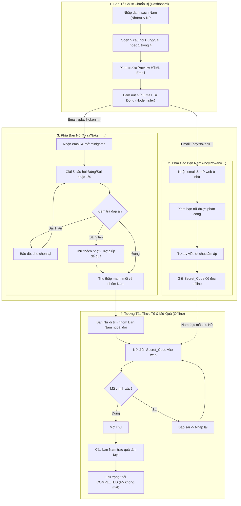

# GDG-HUST-Website-20-10-26

girls plz keep your eyes away



## Architecture & Files

| File / Path | Purpose |
| --- | --- |
| src/routes/__root.tsx | Root layout, header, and global providers |
| src/routes/index.tsx | Main page with interactive wish tree |
| src/routes/boy.tsx | Boy portal to write wishes and generate secret codes |
| src/routes/play.tsx | Girl quiz minigame page |
| src/routes/dashboard.tsx | Organizer dashboard for rosters, quiz configs, email previews |
| src/features/wish-garden/ViralTree2010.tsx | SVG wish tree renderer and animations |
| src/features/wish-garden/WishGarden.tsx | Wish garden controller and token handler |
| src/features/wish-garden/BoyWishPage.tsx | Wish writing view |
| src/features/wish-garden/BoyWishComposerModal.tsx | Wish creation modal |
| src/features/wish-garden/SecretCodeModal.tsx | Secret code input modal |
| src/features/wish-garden/WishLetterRevealModal.tsx | Unlocked letter viewer modal |
| src/features/quiz/QuizPlay.tsx | Minigame logic and question transitions |
| src/features/admin/Dashboard.tsx | Admin management panel |
| src/services/app-database.ts | Database client (Supabase sync with localStorage fallback) |
| src/services/email-template.ts | Email generator and CSV/JSON roster exports |
| src/services/supabase.ts | Supabase client initialization |
| supabase/setup.sql | Database schema, tables, public RLS policies, replication |
| .github/workflows/deploy.yml | GitHub Actions build and Pages deployment workflow |
| vite.config.ts | Vite build config and static environment variable bindings |

## Build from GitHub Pages (Supabase)

1. Run `supabase/setup.sql` in your Supabase project SQL Editor.
2. In GitHub repo Settings > Secrets and variables > Actions, add:
   - `VITE_SUPABASE_URL`: Your Supabase URL
   - `VITE_SUPABASE_ANON_KEY`: Your Supabase anon key
3. Push to `main` to trigger automatic build and deploy.

## Build Locally (npm)

```bash
# Install dependencies
npm install --legacy-peer-deps

# Start dev server
npm run dev

# Run tests, typecheck, lint
npm test
npm run typecheck
npm run lint

# Build for production
npm run build
```
